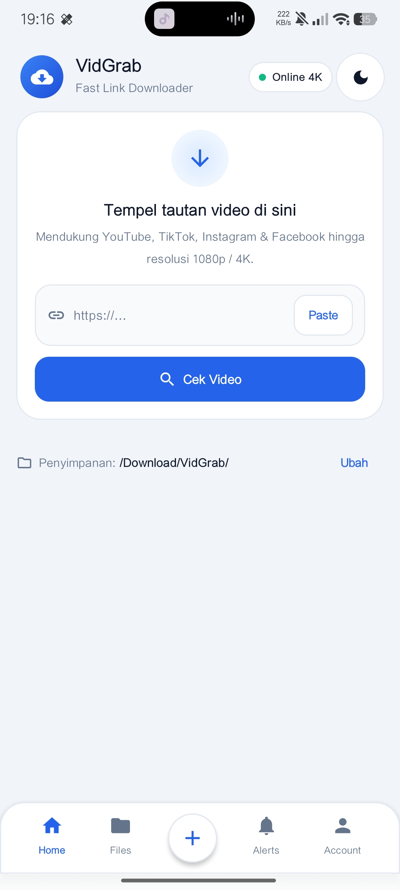
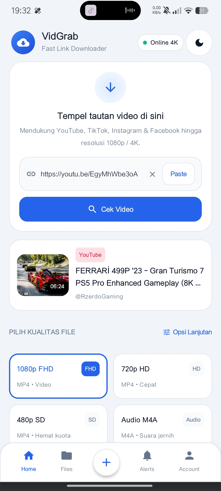
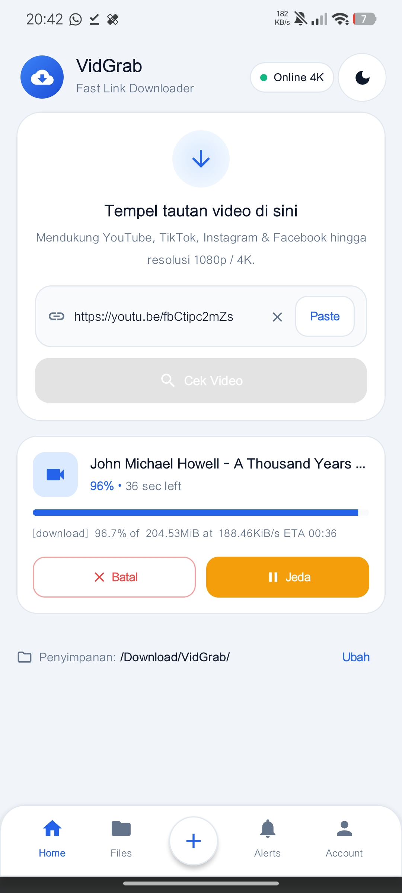
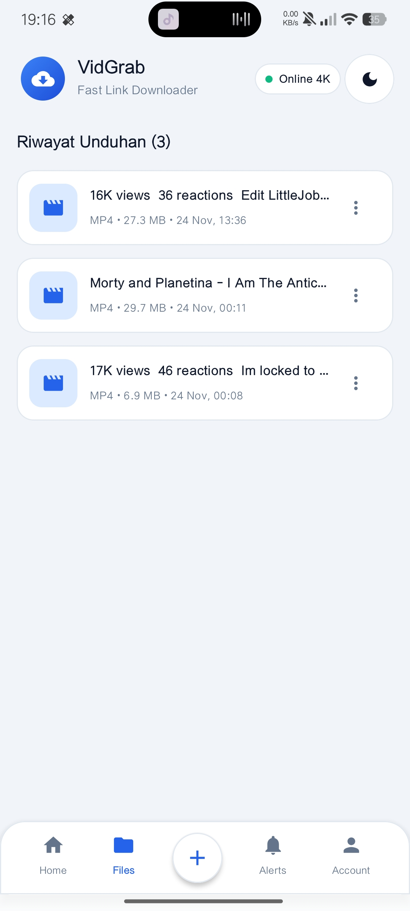
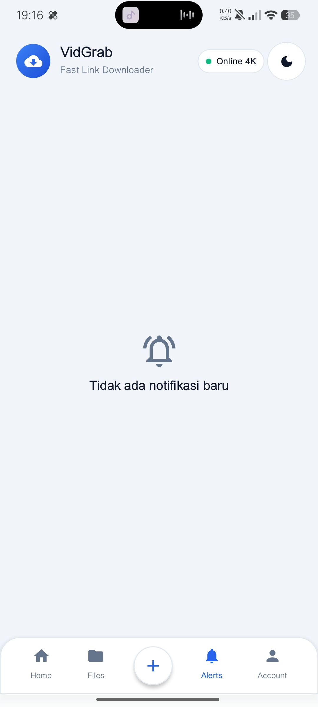
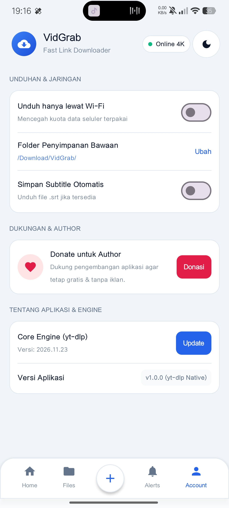
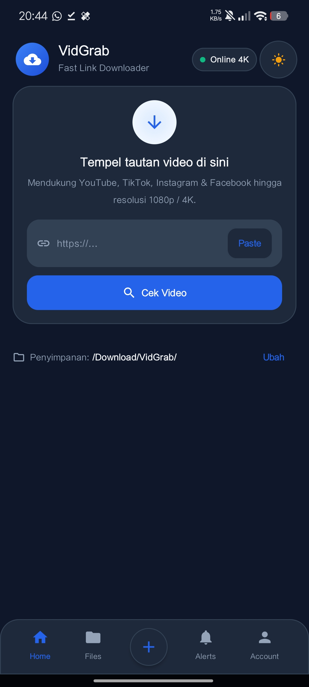
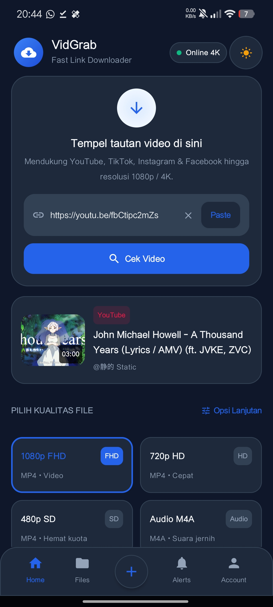
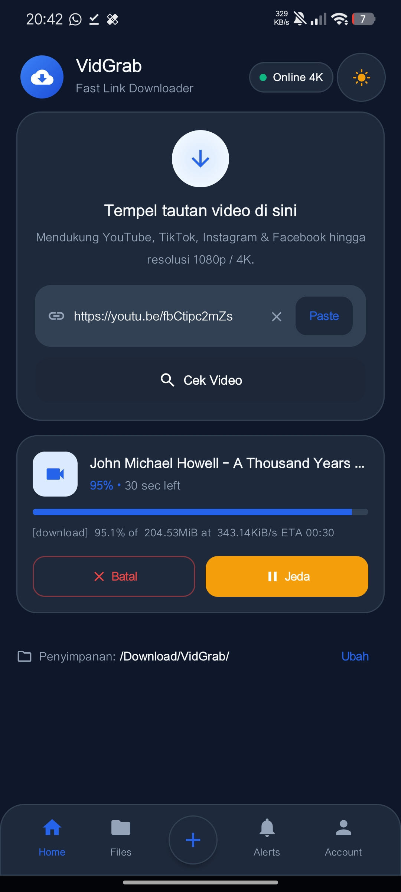
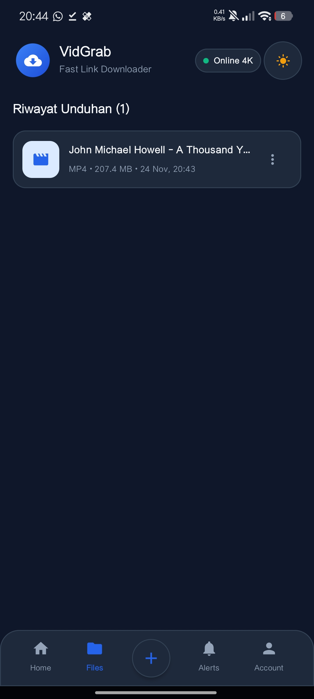

# VidGrab — Fast Link Downloader

Aplikasi pengunduh video dan audio Android berbasis **Kotlin + Jetpack Compose** dengan mesin native **yt-dlp** dan **FFmpeg**. Dirancang agar ringan, hemat baterai, mendukung jeda/lanjutkan unduhan (`--continue`), pembersihan file `.part` saat dibatalkan, serta tema **Light Mode** dan **Dark Mode**.

---

## ✨ Fitur Utama

- **Ekstraksi & Unduhan Multi-Platform:** Mendukung YouTube, TikTok, Instagram, Facebook, dan tautan video web.
- **Pilihan Kualitas & Audio:** Tersedia opsi resolusi video (`4K UHD`, `2K QHD`, `1080p FHD`, `720p HD`, `480p SD`) serta ekstraksi suara (`Audio M4A`).
- **Kontrol Jeda (Pause), Lanjut (Resume) & Batal:** Hentikan sementara unduhan tanpa mengulang dari awal, atau batalkan dan bersihkan file sementara `.part`.
- **Opsi Lanjutan & Jaringan:** Dukungan pemilihan video codec (`H.264`, `VP9`, `AV1`), pengunduhan subtitle (`.srt`), mode *Wi-Fi Only*, serta pengaturan folder penyimpanan kustom.
- **Manajemen File & Riwayat:** Putar langsung, bagikan, atau hapus file hasil unduhan melalui tab **Files**.
- **Pembaruan Engine yt-dlp:** Perbarui *core engine* langsung dari tab **Account** agar kompatibilitas platform selalu terjaga.
- **Light & Dark Theme:** Beralih tema terang maupun gelap secara instan dari *header* aplikasi.

---

## 📱 Tangkapan Layar (Screenshots)

### ☀️ Light Mode

| Home (Input Link) | Home (Hasil Analisis & Kualitas) | Home (Proses Unduh) |
| :---: | :---: | :---: |
|  |  |  |

| Files (Riwayat Unduhan) | Alerts (Notifikasi) | Account (Pengaturan & Engine) |
| :---: | :---: | :---: |
|  |  |  |

---

### 🌙 Dark Mode

| Home (Input Link) | Home (Preview Video & Kualitas) | Home (Proses Unduh) | Files (Riwayat Unduhan) |
| :---: | :---: | :---: | :---: |
|  |  |  |  |

---

## 🛠️ Spesifikasi Teknis

- **Bahasa & UI:** Kotlin, Jetpack Compose, Material 3
- **Core Engine:** `youtubedl-android` (`yt-dlp` + `FFmpeg`)
- **Arsitektur Target:** `arm64-v8a` (64-bit) dengan optimasi R8 (`minifyEnabled` & `shrinkResources`)
- **Minimum SDK:** Android 7.0 (API 24)

---

## 📦 Cara Instalasi

1. Buka halaman **Releases** pada repositori GitHub ini.
2. Unduh file APK rilis terbaru .
3. Izinkan instalasi dari sumber tidak dikenal (*Unknown Sources*) di perangkat Android bila diminta, lalu pasang APK.

---

## 💖 Dukungan & Author

Aplikasi ini dikembangkan untuk penggunaan yang ringan dan bebas iklan. Jika terbantu dengan proyek ini, dukungan dapat dikirimkan melalui menu **Donate untuk Author** di tab **Account**.
